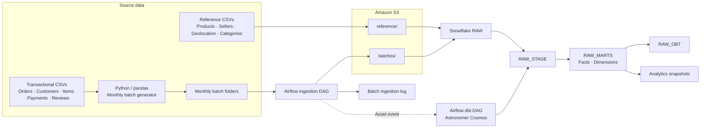

# 🛒 E-commerce Batch Analytics Platform


> **An end-to-end e-commerce batch analytics platform built around SQL, Snowflake, dbt, and data modeling.**  
> Reference data is loaded separately, while transactional data is processed in monthly batches through Amazon S3, orchestrated with Airflow, and transformed into analytics-ready models with dbt.

**Primary focus:** `SQL` · `Snowflake` · `dbt` · `Data Modeling`  
**Supporting engineering:** `Python` · `pandas` · `Amazon S3` · `Airflow` · `Astronomer Cosmos` · `Docker`

**Project scope:** `2` Airflow DAGs · `15` dbt SQL models · `5` transactional datasets · `4` reference datasets

---

## Architecture



## Ingestion Strategy

| Path | Data | Processing |
|---|---|---|
| **Reference load** | Products, sellers, geolocation, category translations | Uploaded once under S3 `reference/` and loaded into Snowflake RAW tables. |
| **Monthly batches** | Orders, customers, order items, payments, reviews | Split into `batch_YYYY-MM` folders, uploaded under `batches/`, and loaded one batch per run. |

## SQL, Snowflake & dbt

Snowflake is the central warehouse. dbt transforms source-aligned RAW tables into tested analytical models.

| Layer | Contents |
|---|---|
| `RAW` | Source tables and batch ingestion log |
| `RAW_STAGE` | 9 staging models |
| `RAW_MARTS` | 2 fact and 3 dimension models |
| `RAW_OBT` | 1 One Big Table model |
| `RAW_ANALYTICS_SNAPSHOTS` | Snapshot history |

The dbt project also includes an order-status seed, YAML tests, and singular SQL tests.

## Airflow & Orchestration

| DAG | Purpose |
|---|---|
| `ecommerce_s3_to_snowflake` | Finds the oldest eligible monthly batch, uploads its files to S3, loads Snowflake RAW tables, and records ingestion. |
| `ecommerce_dbt_pipeline` | Runs dbt through Astronomer Cosmos after the ingestion DAG emits an Airflow asset event. |

The next batch is gated on dbt completion, followed by a five-minute safety cooldown. Each ingestion run processes at most one monthly batch.

## Engineering Outcomes

- **Separated ingestion paths** for one-time reference data and recurring transactional batches.
- **Controlled batch processing** with a Snowflake control table, sequential discovery, and existing-object checks in S3.
- **Event-driven transformation handoff** from successful Snowflake ingestion to the dbt workflow.
- **Analytics-ready data models** organized into staging, facts, dimensions, snapshots, and a denormalized OBT.

## Repository Structure

```text
.
├── airflow/              # Airflow Dockerfile and DAGs
├── ecommerce_dbt/        # dbt models, tests, seeds, snapshots
├── scripts/              # Monthly batch generation
├── snowflake/            # Warehouse and ingestion SQL
├── docker-compose.yml
├── requirements.txt
└── README.md
```

## Running Locally

1. Clone the repository and install the root Python dependencies with `pip install -r requirements.txt`.
2. Place source CSVs in the local `Data/Source/` directory and generate monthly batches with `scripts/generate_batches.py`.
3. Configure the local dbt profile at `ecommerce_dbt/.dbt/profiles.yml`, plus the AWS and Snowflake connections required by Airflow.
4. Review the SQL setup scripts under `snowflake/`, then start the environment:

```bash
docker compose up -d --build
```

Source data, generated batches, virtual environments, logs, `.env` files, and local dbt profiles are excluded from version control.

## Security

- Keep AWS and Snowflake credentials in environment variables or Airflow connections.
- Do not commit secrets, `.env` files, local dbt profiles, or source datasets.
- The Snowflake storage integration and Airflow's AWS credentials serve separate access roles.

## Data Source

Source records are from a publicly distributed Brazilian e-commerce dataset provided by **Olist** (2016–2018). This project focuses on the ingestion, orchestration, warehouse modeling, and analytics engineering implementation.


---

## Author

**Akash Verma**  
`SQL` · `Snowflake` · `dbt` · `Data Engineering`

[GitHub](https://github.com/Akash-dev5)
